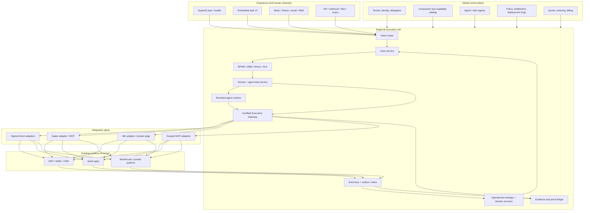
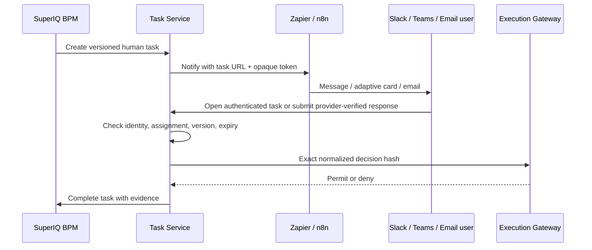

# SuperIQ Foundational Architecture

**Status:** proposed architecture baseline  
**Date:** 2026-08-21  
**Product:** [thesuperiq.com](https://thesuperiq.com)  
**Decision:** build SuperIQ as a governed AI-BPM operations platform over existing systems, not as another chatbot, integration canvas, or system-of-record replacement.

## 1. Executive decision

SuperIQ should combine five proven product ideas at the correct abstraction:

1. **Zip:** one intelligent intake surface, specialist agents embedded at governed workflow steps, and orchestration across existing systems.
2. **UPTIQ:** packaged domain suites composed from reusable skills, integrations, governance, and model-independent execution.
3. **Palantir:** an operational ontology that gives humans and agents the same governed nouns, relationships, actions, permissions, provenance, and scenario model.
4. **Zapier:** a managed long-tail SaaS connector fabric and familiar human communication/approval channels.
5. **n8n:** a self-hostable integration runtime for private networks, custom nodes, data transformation, and edge workflows.

SuperIQ must own the durable operating truth:

- the business case and its state;
- the canonical operational object graph;
- process, decision, policy, and task state;
- agent, skill, capability, and deployment definitions;
- authorization of every effect;
- evidence, audit, execution receipts, and outcome reconciliation.

Zapier, n8n, MCP servers, and direct adapters are replaceable **capability providers**. They do not own the case, decide authority, hold SuperIQ policy, or determine that work is complete.

The core execution spine is:

```text
request / event / document
→ typed intent
→ durable Case
→ versioned BPMN/DMN process
→ assigned human, service, or agent task
→ policy decision
→ deterministic capability request
→ Certified Execution Gateway
→ direct | Zapier | n8n | MCP connector
→ external system effect
→ signed receipt + evidence
→ state reconciliation
→ next task or verified completion
```

## 2. What the market evidence says

These are observable product patterns from vendors' own current materials, not claims about their private internal implementation.

| Platform | Verified pattern | Adopt | Do not copy |
|---|---|---|---|
| Zip | Specialist agents work inside orchestrated processes with integrated system context, workflow triggers, human controls, and decision history. Zip also argues that a single omnipotent agent is the wrong model. ([source](https://ziphq.com/blog/why-agentic-procurement-orchestration-matters-now)) | Intelligent intake, role-specific agents, workflow placement, end-to-end visibility | Procurement-specific object model or marketing-led “agent count” |
| UPTIQ | QORE combines multi-model AI, workflow automation, financial skills, integrations, audit, RBAC, and human review; packaged suites sit over existing systems. ([platform](https://www.uptiq.ai/platform), [marketplace](https://www.uptiq.ai/marketplace)) | Domain suites, skills marketplace, configure-and-deploy lifecycle, source citations | Financial-services-only semantics or unverifiable performance claims |
| Palantir | AIP runs AI workflows over an Ontology that models operational nouns and verbs; tools/actions are permissioned and observable, while AIP Evals and the availability-limited, Beta Scenarios feature support evaluation and simulation. ([AIP architecture](https://www.palantir.com/docs/foundry/architecture-center/aip-architecture), [scenarios](https://www.palantir.com/docs/foundry/ontology/overview-ontology-scenario)) | Operational ontology, actions as governed verbs, provenance, simulations, evals, deployment discipline | A monolithic proprietary data platform or unrestricted agent SQL |
| Zapier | Zapier MCP exposes thousands of application actions while Zapier manages connections and rate limits; its Human in the Loop step can pause automation for review. ([MCP](https://docs.zapier.com/mcp/home), [HITL](https://help.zapier.com/hc/en-us/articles/38731463206029-Request-approval-to-keep-your-workflow-running-with-Human-in-the-Loop)) | Fast SaaS coverage, notifications, low-risk actions, citizen-built edge automations | Giving a general MCP connection broad production authority or using Zaps as the canonical process ledger |
| n8n | n8n combines workflow automation and AI, supports self-hosting and custom nodes, and documents a human-in-the-loop pattern for reviewing AI tool calls. ([overview](https://docs.n8n.io/), [human review](https://docs.n8n.io/advanced-ai/human-in-the-loop-tools/)) | Private/edge runtime, transformation, custom protocols, optional tenant-dedicated deployment | Running arbitrary customer code inside the trusted SuperIQ control plane |

The winning synthesis is therefore **ontology + case/process + governed agents + integration fabric + human task fabric**, delivered as installable business solutions.

## 3. Product boundary

### SuperIQ is

- a multi-tenant operating layer over ERP, WMS, CRM, finance, identity, document, carrier, marketplace, and specialist systems;
- a durable case and process platform for human-agent-service work;
- an operational ontology and action registry;
- an Agent Studio, Process Studio, Integration Studio, and Component Studio;
- a governed execution, evidence, evaluation, and deployment system;
- initially optimized for circular commerce: intake, grading, refurbishment, parts, inventory, commerce, fulfillment, settlement, trust, and impact.

### SuperIQ is not

- an ERP/WMS replacement;
- a thin chat shell over APIs;
- a clone of Zapier or n8n;
- an LLM that owns workflow state;
- a marketplace of prompts labelled as agents;
- a second identity, policy, or audit path beside the platform control plane;
- a platform where models receive database, OAuth, shell, or unrestricted MCP credentials.

## 4. Logical architecture



### Plane ownership

| Plane | Owns | Does not own |
|---|---|---|
| Experience | intent capture, task rendering, explanation, evidence presentation | business state or authorization |
| Control | tenants, identity, catalog, definitions, policies, entitlements, releases | individual case execution |
| Execution cell | cases, process/task state, agent runs, gateway decisions, operational projections | global catalog authorship |
| Integration | protocol translation, connection health, delivery, receipts | business completion or policy |
| Analytics/learning | process mining, evaluations, cost and outcome analysis | automatic production mutation |

## 5. The operational ontology

Borrow Palantir's key insight without trying to reproduce Foundry: agents need a governed operational language shared with applications and humans.

### Nouns

Start with stable identifiers for:

```text
Tenant · Organization · Facility · Program · Party · Agreement
PurchaseOrder · Shipment · Lot · Asset · AssetAlias · Evidence
Grade · Disposition · CustodyEntry · InventoryEntry · WorkOrder
Repair · Part · QCResult · Listing · Order · Fulfillment · Return
Invoice · Settlement · JournalEntry · Case · Process · Task
Decision · AgentDeployment · CapabilityExecution · PolicyDecision
```

Physical custody, commercial title, contractual ownership, and accounting ownership are separate facts. IMEI, serial number, SKU, and external IDs are namespaced aliases, not primary keys. Current status and balance are projections rebuilt from events and ledgers.

### Verbs

Agents and humans may request only registered business verbs, for example:

```text
asset.resolve_identity
asset.record_custody
grade.request_assessment
disposition.propose
inventory.reserve
repair.create_work_order
commerce.publish_listing
fulfillment.book_shipment
finance.propose_settlement
case.request_human_decision
```

Each verb resolves to a versioned capability contract. There is no generic `database.query`, `http.request`, `execute_code`, or “use any connected tool” capability in a production agent's authority.

## 6. Where agents are defined

Agents are authored in **Agent Studio**, stored as signed, immutable definitions in the global **Agent Registry**, and instantiated as tenant-scoped **Agent Deployments** in a regional execution cell. A definition is not a running agent.

Use four distinct records:

1. **RoleSpec:** stable mission, authority ceiling, prohibited actions, verifier pairing, and budget.
2. **SkillSpec:** reusable bounded task recipe or BPM subprocess.
3. **AgentDefinition:** accepted intents, eligible skills, context policy, planning leash, evaluation suite, and completion oracle.
4. **AgentDeployment:** tenant/environment binding, concrete capability versions, model policy, secrets references, deployment ring, health, and rollback target.

`TriggerBinding` is separate from the definition and binds a deployed revision to an event type, schedule, API intent, or BPM task. It declares filter, correlation key, debounce/deduplication window, enabled state, and failure destination. Saving an accepted intent or schedule name in Studio does not activate a trigger.

An `AgentDeployment` moves only through `DRAFT → VALIDATED → SHADOW → CANARY → ACTIVE → PAUSED → RETIRED`, with `QUARANTINED` reachable from every running state. Each revision pins its last-known-good predecessor, model allowlist, context data classifications/residency, capability versions, verifier identity, health thresholds, tripwire actions, and rollback procedure. Task claims use a lease with owner, expiry, heartbeat, attempt, and compare-and-swap version; an expired lease never authorizes an effect.

```yaml
apiVersion: superiq.ai/v1
kind: AgentDefinition
metadata:
  id: operations.intake-agent
  version: 1.0.0
spec:
  mission: Convert inbound asset receipts into complete, verified intake cases.
  completionOracle: intake_case_complete_v1
  acceptedIntents:
    - asset.intake.requested
    - shipment.arrived
  processes:
    - asset-intake-bpmn@2.1.0
  eligibleSkills:
    - identity-resolution@1.3.0
    - manifest-reconciliation@1.1.0
    - evidence-quality-check@2.0.0
  capabilities:
    - asset.resolve_identity@1
    - evidence.attach@1
    - case.request_human_decision@1
  contextPolicy:
    objectTypes: [Shipment, Lot, Asset, Evidence, Agreement]
    provenanceRequired: true
    maxAge: PT15M
  autonomy:
    asset.resolve_identity: auto
    evidence.attach: auto
    case.request_human_decision: auto
    asset.record_custody: gateway_policy
  planning:
    mode: constrained_plan_dag
    maxNodes: 12
    maxParallelism: 4
    retryBudget: 2
  evaluationSuite: intake-agent-evals@1.0.0
  tripwires:
    - cross_tenant_reference
    - invented_capability
    - missing_provenance
    - repeated_no_progress
```

### Capability contract

Every effectful verb must declare:

```yaml
id: inventory.reserve@1
inputSchema: inventory.reserve.request.v1
outputSchema: inventory.reserve.receipt.v1
risk: medium
permissions: [inventory.reserve]
entitlements: [inventory-core]
preconditions:
  - asset is eligible for allocation
  - requested version equals current aggregate version
idempotency: tenant + capability + normalized request key
confirmation: required above policy threshold
evidence: [source_order, inventory_version, gateway_receipt]
compensation: inventory.release@1
reconciliation: inventory.reservation.reconcile@1
providers: [direct-wms, n8n-private-wms]
```

The gateway selects an eligible provider only after normalizing the request and evaluating tenant, user/delegation, role, process task, entitlement, policy version, risk, confirmation, and current state.

## 7. Agent runtime: bounded reasoning, durable work

The LLM may:

- classify intent;
- extract structured facts with citations;
- investigate approved context fragments;
- propose a bounded PlanDAG using registered skills/capabilities;
- perform assigned analysis or content tasks;
- explain decisions and exceptions.

The LLM may not:

- own timers, retries, SLA, process completion, or compensation;
- fabricate a tool, object, permission, or source;
- select or retrieve arbitrary credentials;
- call a raw SaaS API, database, Zapier MCP server, n8n webhook, or shell;
- approve its own output or change its own production definition;
- claim success without a reconciled operational outcome.

Material work produces a proof chain:

```text
RoleSpec
→ WorkOrder
→ AttemptRecord
→ hashed OutputArtifact
→ independent VerificationRecord
→ PolicyDecision
→ GatewayReceipt
→ OutcomeRecord
→ LearningRecord (when warranted)
```

## 8. Human connection through existing systems

Humans should not be forced into a new inbox for every action. SuperIQ publishes tasks to existing channels while retaining task truth and authorization.

### Human task flow



Rules:

- Slack, Teams, email, SMS, or Zapier are notification and interaction channels, not identity authorities.
- High-risk decisions open a SuperIQ-hosted adaptive task page with verified SSO.
- Authoritative approvals require SuperIQ SSO or a cryptographically verified provider user identity mapped to the assigned enterprise identity. An email-link bearer token alone can acknowledge receipt but cannot approve an effect.
- A provider callback must pass provider signature verification and map provider tenant, channel, and user IDs to the assigned identity. The one-time nonce is consumed atomically with a compare-and-swap on task version. Forwarded, replayed, expired, revoked, unmapped, delegated-after-issue, or CSRF/session-mismatched responses are rejected and audited.
- Low-risk acknowledgement links use an opaque token bound to tenant, task, assignee, action set, payload hash, nonce, and expiry; they cannot change state beyond `ACKNOWLEDGED`.
- Editing data creates a new proposal version; an earlier approval never authorizes changed content.
- Every decision records human identity, channel, task version, policy version, exact normalized request hash, timestamp, and evidence.
- Timeout, delegation, escalation, rejection, rework, and separation-of-duty paths are BPM state, not prompt instructions.

## 9. Zapier and n8n integration strategy

Use a single internal `ConnectorProvider` contract with four implementations:

| Provider | Best use | Default trust tier |
|---|---|---|
| Direct signed adapter | high-volume, material, regulated, latency-sensitive system actions | highest |
| Zapier action/MCP adapter | long-tail SaaS, messaging, CRM/task updates, early integrations | medium |
| n8n managed adapter | complex transformation and organization-controlled workflows | medium |
| n8n private edge | on-prem/private APIs, warehouse systems, customer VPC | medium-high after attestation |

### Inbound

Zapier/n8n sends a signed `IntegrationEvent` to the SuperIQ ingress gateway. SuperIQ authenticates the connection, derives the tenant from the connection—not the payload—deduplicates the event, stores raw evidence, maps it to a canonical event, and correlates it to a case/process.

### Outbound

The execution gateway issues a short-lived, single-use `CapabilityInvocation` containing only the chosen provider, normalized payload, idempotency key, deadline, and callback reference. The provider returns a `CapabilityReceipt`; SuperIQ independently reconciles the external state when material.

### Non-negotiable controls

- Credentials live in the provider vault or SuperIQ Secret Manager, never in prompts, definitions, case data, or browser state.
- One tenant connection cannot be selected by another tenant.
- An agent sees curated capability schemas, not the provider's entire tool catalog.
- Dynamic MCP discovery is permitted in development only; production uses a signed, pinned allowlist.
- Every write is idempotent; distributed effects have explicit compensation and reconciliation.
- Webhook signatures, replay windows, provider execution IDs, rate limits, circuit breakers, and dead-letter handling are mandatory.
- A successful Zap/n8n run proves transport execution, not business success. A domain reconciliation closes the capability execution.

### Invocation state and idempotency contract

Each invocation has `PENDING → DISPATCHED → EFFECT_CONFIRMED | EFFECT_DENIED | OUTCOME_UNCERTAIN → RECONCILED | COMPENSATED | MANUAL_REPAIR`. Its client/business idempotency identity is unique across `(tenant_id, capability_id, capability_version, idempotency_key)` and retained for the longer of the provider retry window or seven years for financial/custody effects. The normalized request hash and business key are stored attributes, not parts of that unique identity. Reusing the identity with a different request hash or business key returns `409 IDEMPOTENCY_CONFLICT`.

The inbox has a unique `(tenant_id, provider_id, provider_event_id)` constraint. Callback nonce consumption and state transition are one transaction. Timeouts after dispatch enter `OUTCOME_UNCERTAIN`; they are never blindly retried when the provider may have committed. A provider-specific reconciler queries the declared authoritative endpoint on an exponential schedule bounded by the capability SLA. Compensation runs only when the capability declares reversibility and its preconditions still hold; irreversible or contradictory state enters `MANUAL_REPAIR` and pulls Andon when material.

## 10. Durable process and case kernel

Use BPMN for long-running orchestration and DMN for deterministic decisions. The process engine owns:

- process instance and version;
- user, agent, service, and decision tasks;
- timers, deadlines, SLA, escalation, and boundary events;
- parallel branches and joins;
- retries, incidents, compensation, cancellation, and migration;
- task assignment and completion;
- terminal outcome state.

Use adaptive case management for novel exceptions. The planner may compose only signed process fragments into a constrained PlanDAG. It cannot generate arbitrary production BPMN.

Every Case retains the original request, canonical facts, hypotheses, findings, decisions, artifacts, evidence, object links, task/process correlation, SLA, and append-only timeline.

## 11. Intent-driven application model

The front door accepts natural language, form submissions, files, scans, APIs, and events. It produces a typed `IntentEnvelope`, then opens or correlates a Case.

The UI is generated from registered task components, not arbitrary model HTML:

```json
{
  "taskId": "task_123",
  "taskVersion": 7,
  "intent": "disposition.review",
  "objectRefs": ["asset_456", "grade_789"],
  "components": [
    {"type": "EvidenceGallery", "propsRef": "evidence-set:44"},
    {"type": "DecisionSummary", "propsRef": "proposal:18"},
    {"type": "ActionForm", "schemaRef": "disposition.review.v2"}
  ],
  "allowedActions": ["approve", "reject", "request_rework"],
  "policyVersion": "policy-2026.08.1"
}
```

The server rechecks entitlement, assignment, task version, schema, policy, and state on submission. Hidden buttons are not authorization.

## 12. Multi-tenancy, security, and governance

### Tenant isolation

- Derive tenant from verified user identity, workload identity, or connection binding.
- Scope every table row, object, event, evidence blob, cache key, queue item, trace, vector record, agent context, and cost record.
- Enforce tenant-aware repositories and PostgreSQL RLS as defense in depth.
- Offer dedicated regional cell/database/VPC tiers for regulated or large tenants.

### Authorization

Combine RBAC and ABAC over tenant, facility, program, object state, ownership, amount, risk, data classification, and separation of duties. Agent authority is the intersection of:

```text
tenant entitlement
∩ active AgentDeployment
∩ RoleSpec ceiling
∩ process-task assignment
∩ capability permission
∩ current policy decision
∩ exact confirmation hash (when required)
```

### AI security

- Treat all external content, including connector payloads and retrieved documents, as untrusted.
- Separate instructions, trusted facts, untrusted content, and tool results.
- Require structured model output and schema validation.
- Minimize PII and use an AI Gateway for provider routing, quotas, logging, and redaction.
- Evaluate prompt injection, exfiltration, confused deputy, invented tool, cross-tenant retrieval, and excessive agency attacks.
- Support agent-, tenant-, capability-, connector-, and platform-level kill switches.

### Andon and pre-effect safety

Immediately before every effect, the gateway re-resolves live tenant status, deployment status, entitlement, assignment lease, object version, confirmation hash/expiry, policy version, spend/exposure, connector health, and separation-of-duty constraints. A simulation or earlier approval cannot bypass this time-of-check/time-of-use recheck.

The containment state machine is deterministic:

```text
RUNNING → PAUSE_NEW_WORK → REVOKE_CONNECTION/AGENT LEASES
→ FREEZE EFFECTS AND SPEND → SNAPSHOT STATE/EVIDENCE
→ ROOT-CAUSE RECORD → REPAIR CANDIDATE → ADVERSARIAL REPLAY
→ SHADOW → CANARY → RESUME
```

If replay/canary cannot certify recovery, the terminal state is `HIBERNATE`: preserve records and capital, continue only legally required obligations, and deny new business effects. No agent, verifier, or workflow may clear its own Andon.

## 13. Deployment topology on GCP

### Global control plane

- Global HTTPS Load Balancer, Cloud Armor, Cloud CDN
- tenant/identity/subscription/catalog services on Cloud Run
- signed component and agent registries
- placement, quotas, billing meters, deployment rings

### Regional execution cell

- Cloud Run: BFF, intent, case, task, agent runtime, execution gateway, modular domain APIs
- Camunda 8/Zeebe on GKE Autopilot for BPMN/DMN, pending an ADR and load/operations proof
- AlloyDB/PostgreSQL for transactional state
- Pub/Sub with transactional outbox/inbox
- Cloud Storage for immutable evidence and large artifacts
- Memorystore only for ephemeral cache/coordination, never truth
- Secret Manager, KMS, IAM/workload identity
- OpenTelemetry, Cloud Logging/Trace, Managed Prometheus

The first production cell targets **99.9% monthly case/task API availability**, **RPO ≤ 5 minutes**, and **RTO ≤ 60 minutes**; higher tiers may raise these after load and recovery evidence. PostgreSQL uses multi-zone HA, point-in-time recovery, daily cross-region encrypted backups, and quarterly restore tests. Evidence storage uses object versioning/retention and cross-region replication where tenant residency permits. Pub/Sub ordering keys are `(tenant_id, aggregate_id)`; consumers tolerate cross-key reordering and use inbox dedupe.

The global router maps each tenant to one home region/cell from verified identity before request processing. Case, workflow, evidence, and connector credentials remain in that residency boundary. Cross-region analytics receives only contractually allowed data. A cell disaster promotes a pre-declared recovery cell only after database restore/replication, workflow-state recovery, secret/identity checks, and reconciliation of all `DISPATCHED` or `OUTCOME_UNCERTAIN` effects.

Camunda tenancy is not assumed: the Phase 0 ADR must prove tenant isolation, authorization, history retention, backup/restore, process version migration, and operator access. Until it passes, the production engine choice remains blocked; the reference slice may use an isolated non-production spike, but no alternative engine may weaken the Case/Task contracts.

### Analytics and learning plane

- BigQuery event/outcome lakehouse
- process mining and bottleneck analysis
- evaluation datasets and replay harness
- cost, quality, latency, safety, and business-outcome cohorts

Start as a modular platform. Extract services only when independent security, scale, ownership, or deployment requires it. Do not begin with one microservice per noun.

## 14. Installable SuperIQ components

The commercial unit is a signed **SolutionComponent**, not a menu item:

```text
SKU and meters
+ dependencies and regional eligibility
+ ontology extensions
+ BPMN/DMN processes
+ agent definitions and skills
+ deterministic capabilities
+ UI task blocks
+ permissions and policies
+ canonical commands/events
+ connector mappings
+ reports and evaluations
+ migrations and synthetic health tests
+ rollback
```

Initial circular-operations components:

1. **IntakeIQ:** intelligent intake, manifest reconciliation, identity, custody, discrepancy cases.
2. **GradeIQ:** evidence capture, deterministic tests, vision assessment, grade policy, agreement feedback.
3. **RefurbIQ:** repair planning, parts, work orders, QC, labor and yield.
4. **InventoryIQ:** locations, custody, reservations, serialized inventory, reconciliation.
5. **CommerceIQ:** channel eligibility, pricing, listings, allocation, returns.
6. **FulfillmentIQ:** pick/pack/ship, carrier booking, proof of delivery, exceptions.
7. **SettlementIQ:** invoices, three-way matching, accruals, settlement, financial reconciliation.
8. **TrustIQ:** ownership, wipe, R2/compliance evidence, provenance, claims.
9. **ImpactIQ:** traceable environmental outcomes with methodology and evidence versions.

## 15. Complete reference workflow: inbound device receiving

This is the first vertical slice because it crosses human intake, GradeIQ, operational objects, process state, connectors, evidence, and a real completion oracle.

### Trigger

A shipment-arrival scan, ASN webhook, file upload, or user request creates an `asset-intake` Case.

### Flow

1. Resolve tenant, facility, program, shipment, and expected manifest.
2. Create BPM process pinned to component, process, policy, agent, skill, and capability versions.
3. Human scans IMEI/serial and captures minimum evidence through an active-task UI.
4. Intake Agent resolves identity and checks manifest; unannounced assets remain valid but open discrepancy work.
5. GradeIQ runs deterministic/vision checks and returns cited evidence plus a versioned grade proposal.
6. Independent rules verify required evidence, identity consistency, and grade confidence.
7. DMN selects auto-accept, human review, re-capture, quarantine, or fraud/compliance exception.
8. Gateway records custody and inventory through a direct WMS adapter or n8n private edge.
9. Connector receipt is reconciled against the WMS record.
10. Case completes only when custody, inventory, evidence, grade, and discrepancy state satisfy the oracle.

### Acceptance oracle

```text
PASS only if:
- exactly one tenant-scoped asset identity is resolved or an explicit ambiguity case exists;
- custody transition is recorded with actor, facility, timestamp, and source evidence;
- required GradeIQ evidence is present and version-pinned;
- manifest outcome is matched, over, short, or unannounced—never silently guessed;
- WMS/ERP effect has a gateway receipt and reconciliation result;
- every open exception has an owner, SLA, and next task;
- no cross-tenant reference, unregistered capability, or unverifiable claim exists.
```

## 16. Current GradeIQ foundation and gaps

The present repository contains useful seeds but not the target platform:

| Existing foundation | Evidence | Architectural interpretation |
|---|---|---|
| Session record with tenant/client ID and structured grading data | `lib/db.ts` | A useful GradeIQ domain aggregate; not yet the universal Case model |
| Append-only session events and caller-supplied client filtering | `lib/events.ts` | Good event/audit seed, but this is not repository-enforced tenant isolation; audit writes currently never fail the business action and are not yet a durable proof ledger |
| Keycloak M2M token verification/minting | `lib/serviceToken.ts` | Good service-identity seed for signed service calls |
| Platform-wide integration settings | `app/superadmin/IntegrationsPanel.tsx` | Configuration UI only; it is not a tenant connector registry or runtime |
| GradeIQ-to-SuperIQ diagnostic push | `app/api/report/[id]/push-superiq/route.ts` | A real integration seam to convert into a canonical event/capability contract |
| Organization/execution-gateway prototype | `fleetmatch-ai/src/organization.js`, `fleetmatch-ai/src/service.js` | Valuable reference for WorkOrders, gateway checks, idempotency, evidence, and audit; not production SuperIQ infrastructure |
| Additive multi-tenant design | `docs/MULTITENANT-DESIGN.md` | Preserves current client identifiers and offers a safe GradeIQ migration path |

The migration should extract and generalize these patterns without forcing GradeIQ into a big-bang rewrite.

## 17. Phased implementation roadmap

### Phase 0 — architecture contracts and golden cases (2–3 weeks)

- Approve ADRs for Case/BPM kernel, ontology/action model, connector boundary, evidence/proof ledger, tenancy, and agent deployment.
- Define canonical IDs, `IntentEnvelope`, Case, Task, CapabilitySpec, AgentDefinition, AgentDeployment, PolicyDecision, IntegrationEvent, GatewayReceipt, and OutcomeRecord schemas.
- Build a threat model and five golden-case replay fixtures.
- Select Camunda/Zeebe only after a small operational spike proves versioning, incident handling, task correlation, and tenancy approach.

**Exit:** schemas validate; architectural fitness tests reject raw agent tools, missing tenant scope, and unversioned effects.

### Phase 1 — Case, process, and task spine (4–6 weeks)

- Tenant-aware Postgres repositories and append-only event/proof ledger.
- Case and task services, BPM workers, DMN decisions, outbox/inbox, evidence store.
- Registered task UI and SSO-based human task flow.
- GradeIQ session-to-case projection without changing existing grading behavior.

**Exit:** an inbound device case survives restart, timer, retry, reassignment, stale submission, and replay.

### Phase 2 — execution gateway and connector abstraction (4–6 weeks)

- Capability registry and deterministic gateway.
- Direct webhook/REST adapter plus Zapier and n8n providers.
- Connection vault references, signatures, idempotency, circuit breakers, receipts, compensation, reconciliation.
- Slack/email task notification through Zapier; private WMS proof through n8n.

**Exit:** no external write bypasses the gateway; duplicate/reordered callbacks create one business effect.

### Phase 3 — deployable agent runtime (4–6 weeks)

- Agent/skill registry, deployment records, model gateway, context broker, constrained PlanDAG.
- WorkOrder/proof chain, independent verifier, evaluation/replay harness, shadow and canary rings.
- Intake Agent bound to the device receiving BPM process.

**Exit:** agent definition, deployment, runtime invocation, action authorization, proof, health, and rollback are demonstrably distinct.

### Phase 4 — Studio and component packaging (6–10 weeks)

- Integration, Process, Agent, and Component Studio workspaces.
- Signed `IntakeIQ + GradeIQ` component with dependencies, migrations, policies, UI blocks, connectors, meters, tests, and rollback.
- Tenant installation, entitlement enforcement, synthetic tests, shadow/canary promotion.

**Exit:** a clean tenant can install the package and complete the golden receiving case without manual database/config edits.

### Phase 5 — domain expansion

Expand one verified end-to-end component at a time: RefurbIQ → InventoryIQ → CommerceIQ → FulfillmentIQ → SettlementIQ → TrustIQ/ImpactIQ. Reuse ontology, process, gateway, proof, UI, and connector foundations; do not introduce parallel control paths.

## 18. Architecture decisions to make now

| ADR | Recommendation |
|---|---|
| Core workflow engine | BPMN/DMN engine owns durable process; agents perform tasks |
| Agent definition location | Signed global registry + tenant-scoped deployment binding |
| Agent tool access | Curated CapabilitySpecs only; no raw APIs/SQL/general MCP |
| Integration strategy | Direct adapters for strategic/material effects; Zapier for SaaS reach; n8n for private/custom edge |
| Human work | SuperIQ Task Service is source of truth; existing channels notify and collect bounded responses |
| Operational data | Canonical object graph plus append-only ledgers; external systems remain authoritative by declared field/domain |
| Exactly-once | Do not promise it; implement idempotency, outbox/inbox, optimistic versions, compensation, reconciliation |
| Runtime topology | Modular Cloud Run services + regional cells; extract only on measured boundaries |
| Learning | Candidate versions through replay, simulation, shadow, canary, and rollback; never in-flight self-modification |
| Marketplace | Signed solution components containing process, agents, actions, policies, UI, connectors, evaluation, and migrations |

## 19. Risks and containment

| Risk | Containment |
|---|---|
| “Agent” becomes a prompt plus broad tools | definition schema, capability allowlists, runtime/deployment proof, fitness tests |
| Zapier/n8n becomes shadow workflow truth | all runs correlate to SuperIQ task/case IDs; only SuperIQ closes work |
| Connector success mistaken for business outcome | reconciliation requirement and OutcomeRecord |
| Cross-tenant leakage | derived tenant, repository guards, RLS, context filtering, adversarial tests |
| Workflow and agent version drift | immutable version pins on every Case and WorkOrder |
| Prompt injection from documents/connectors | trust labels, context separation, structured output, tool allowlists, tripwires |
| Microservice sprawl | modular platform first; extraction requires measured security/scale/ownership rationale |
| Proprietary integration lock-in | canonical provider contract and portable capability definitions |
| Human approvals authorize changed payloads | exact payload hash, task version, expiry, and re-approval after edits |
| Autonomous churn without value | bounded loops, retry budgets, independent verification, reconciled outcomes |

## 20. Exact next implementation slice

Build **Intake Case Foundation v0** before building Agent Studio screens:

1. Add schema packages for `Case`, `CaseEvent`, `Task`, `CapabilitySpec`, `CapabilityInvocation`, `GatewayReceipt`, and `IntegrationEvent`.
2. Implement tenant-aware Case/Task repositories in Postgres behind interfaces; preserve current SQLite GradeIQ behavior through an adapter during migration.
3. Model one `asset-intake` BPM process with scan, identity, GradeIQ assessment, discrepancy, human review, custody write, and reconciliation tasks.
4. Implement one registered task UI schema and one Slack/email notification adapter through Zapier.
5. Implement one n8n or direct mock-WMS capability behind the gateway with idempotency and reconciliation.
6. Project the existing GradeIQ session and append-only events into the Case timeline.
7. Add deterministic tests for tenant isolation, stale tasks, duplicate callbacks, policy denial, connector timeout, partial effect, reconciliation mismatch, and rollback.
8. Only then bind the first Intake Agent to the agent-task nodes and run it in shadow mode.

### Stop conditions for implementation

Stop and raise an architecture decision if any implementation requires:

- storing credentials in an agent definition or prompt;
- letting an LLM directly select an arbitrary provider action;
- completing a case from a connector's HTTP 200 alone;
- deriving tenant from request payload;
- bypassing the Case/BPM/task/gateway path for a production effect;
- weakening current GradeIQ behavior before parity tests pass;
- introducing another workflow, policy, audit, or identity source of truth.

This slice proves the platform thesis with one real operational outcome while keeping Zapier, n8n, models, and future systems replaceable.

## 21. Data authority and conflict matrix

“SuperIQ owns durable operating truth” means it is the system of control and proof for work it orchestrates; it does not mean copying every external system of record. Authority is declared per field/domain:

| Domain | Authoritative source | SuperIQ ownership | Conflict rule |
|---|---|---|---|
| Case, process, task, decision | SuperIQ | system of record and control | only append/correct through SuperIQ commands |
| Agent deployment, policy, gateway receipt | SuperIQ | system of record and control | signed version wins; invalid versions quarantine execution |
| Grade proposal and evidence | GradeIQ + immutable evidence store | SuperIQ stores versioned projection/provenance | later warehouse truth is a new truth event, never an overwrite |
| Physical custody | custody ledger in SuperIQ or designated WMS per tenant contract | control and reconciled projection | authoritative custody event wins; contradiction opens custody exception and freezes movement |
| Inventory availability | designated WMS/ERP | reservation workflow and projection | provider read-after-write/reconciliation wins; stale projection cannot allocate |
| Financial balance/payment | designated ERP/bank/processor ledger | proposed entries, gateway receipts, reconciliation | external settled transaction wins; variance opens financial exception; no silent correction |
| Asset identity aliases | SuperIQ identity registry with cited sources | canonical internal ID and alias validity | conflicting aliases create ambiguity case; no automatic merge |
| Evidence blobs | SuperIQ evidence store or declared regulated repository | checksum, custody, provenance, retention metadata | checksum/retention mismatch pulls Andon |

Every correction is a new event referencing the superseded fact. The ontology exposes the authoritative value, source, observed-at time, validity window, confidence, and reconciliation status.

## 22. Executable intake completion oracle

`intake_case_complete_v1` is a deterministic service/DMN decision, not an agent judgment.

### Inputs and authoritative reads

```yaml
input:
  tenant_id: uuid
  case_id: uuid
  expected_case_version: integer
  now: instant
reads:
  case: CaseRepository.get(tenant_id, case_id, expected_case_version)
  asset: IdentityRepository.getResolvedAsset(case.asset_ref)
  ambiguity: CaseRepository.getOpenIdentityAmbiguity(case_id)
  custody: CustodyLedger.latestVerified(asset.id)
  grade: GradeRepository.getPinnedAssessment(case.grade_ref)
  evidence: EvidenceRepository.listVerified(case_id, grade.pins)
  manifest: ManifestRepository.getOutcome(case.shipment_ref, asset.id)
  effect: CapabilityLedger.get(case.inventory_effect_ref)
  tasks: TaskRepository.listOpen(case_id)
```

### Result contract

```yaml
result:
  verdict: PASS | FAIL | RETRY | ANDON
  code:
    - INTAKE_COMPLETE
    - STALE_CASE_VERSION
    - IDENTITY_UNRESOLVED
    - IDENTITY_CONFLICT
    - CUSTODY_UNVERIFIED
    - GRADE_EVIDENCE_MISSING
    - GRADE_PIN_MISMATCH
    - MANIFEST_OUTCOME_MISSING
    - INVENTORY_EFFECT_UNCERTAIN
    - INVENTORY_RECONCILIATION_FAILED
    - OPEN_TASK_WITHOUT_OWNER
    - OPEN_TASK_SLA_MISSING
    - CROSS_TENANT_REFERENCE
    - PROOF_CHAIN_INCOMPLETE
  evidence_refs: [typed immutable references]
  evaluated_case_version: integer
  oracle_version: intake_case_complete_v1
```

### Deterministic rules

Return `ANDON/CROSS_TENANT_REFERENCE` if any resolved reference has a different tenant. Return `FAIL/IDENTITY_UNRESOLVED` unless exactly one resolved identity exists or a versioned ambiguity subcase is open with owner, SLA, and next task; an ambiguity case prevents normal completion and yields `RETRY`, not `PASS`. Custody must be a verified ledger entry for the asset, facility, actor, and receiving event. Grade evidence must satisfy the component's pinned `EvidenceRequirementSet`; every item must match checksum, source, capture time, and grade pins. Manifest outcome must be exactly one of `MATCHED | OVER | SHORT | UNANNOUNCED`. Inventory effect must be `RECONCILED` against the designated WMS/ERP version. Every open exception must have an active assignee/queue, future SLA, and executable next task. The proof chain must resolve from WorkOrder through exact artifact hash, verifier, policy decision, gateway receipt, and reconciliation.

Only all rules passing returns `PASS/INTAKE_COMPLETE`. The oracle writes no business state; BPM performs a compare-and-swap completion using `evaluated_case_version`.

### Required golden fixtures

| Fixture | Expected result |
|---|---|
| `intake-happy-001` | `PASS/INTAKE_COMPLETE` |
| `intake-unannounced-001` | `PASS/INTAKE_COMPLETE` with closed/accepted discrepancy path |
| `intake-identity-ambiguous-001` | `RETRY/IDENTITY_UNRESOLVED` |
| `intake-cross-tenant-001` | `ANDON/CROSS_TENANT_REFERENCE` |
| `intake-grade-pin-drift-001` | `FAIL/GRADE_PIN_MISMATCH` |
| `intake-wms-lost-callback-001` | first `RETRY/INVENTORY_EFFECT_UNCERTAIN`, then `PASS` after authoritative reconciliation |
| `intake-partial-effect-nonmaterial-001` (`policy=intake-risk-v1`, `materiality=LOW`) | `RETRY/INVENTORY_EFFECT_UNCERTAIN`; never duplicate reservation |
| `intake-partial-effect-material-001` (`policy=intake-risk-v1`, `materiality=HIGH`) | `ANDON/INVENTORY_RECONCILIATION_FAILED`; freeze further effects |
| `intake-open-unowned-exception-001` | `FAIL/OPEN_TASK_WITHOUT_OWNER` |

Phase 0 must ship the schemas, pure oracle implementation, and fixtures. Phase 1–3 CI must replay all fixtures; promotion is blocked on any mismatch.

## 23. GradeIQ coexistence, migration, and rollback

The migration is strangler-style and preserves GradeIQ's current SQLite behavior until the Postgres path is proven.

### Mapping and authority

| Current GradeIQ | Target | Coexistence authority |
|---|---|---|
| `sessions.id` | `case.external_ref` + GradeIQ asset-intake projection | SQLite remains authoritative for grading session during Phases 1–2 |
| `sessions.client_id` | verified `tenant.external_ref` mapping | mapping table is immutable after tenant cutover |
| `session_events.id` | source event checkpoint + canonical CaseEvent | SQLite event is source; Postgres projection is replayable |
| grading data JSON columns | versioned GradeAssessment/Evidence references | current GradeIQ result remains authoritative until parity gate |
| Keycloak service token | workload identity/delegation | existing M2M path remains valid behind adapter during compatibility window |

### Backfill and live projection

1. Snapshot SQLite and record checksum, maximum session/event IDs, schema version, and row counts.
2. Backfill idempotently in primary-key order into staging projection tables; record per-batch checkpoints and reject/quarantine malformed rows without skipping silently.
3. Verify counts, canonical hashes, tenant mapping, event order, referential integrity, and a sampled GradeIQ report parity set.
4. Start an outbox/change projector from the checkpoint. Because current writes do not use a transactional outbox, Phase 1 adds one to the SQLite transaction before claiming zero-loss projection.
5. Run Postgres Case reads in shadow; compare API/report outputs and completion-oracle results without serving them.
6. Canary selected internal tenants, then pilot tenants. Keep source-version and projection lag visible.
7. Cut read authority per tenant only after 14 days with zero critical parity failures, projection p99 lag below 60 seconds, successful restore drill, and all golden fixtures passing.

### Write and cutover rule

Do not implement unconstrained dual writes. During coexistence, each domain has one write authority. GradeIQ session writes commit SQLite plus its transactional outbox; projectors write Postgres idempotently. New SuperIQ Case/Task/Gateway records write only Postgres and link to the immutable GradeIQ external reference. After tenant cutover, new case/process data remains Postgres-authoritative while the GradeIQ adapter continues its bounded grading-session responsibility until separately migrated.

### Rollback

- **Before tenant read cutover:** disable projector consumers; SQLite behavior is unchanged. Truncate/rebuild only projection tables from the retained checkpoint/snapshot.
- **After read cutover but before new SuperIQ effects:** route tenant reads back to SQLite adapter; retain Postgres events for diagnosis.
- **After SuperIQ has created tasks/effects:** do not reverse-migrate or discard Postgres state. Pause the tenant, freeze new effects, reconcile every dispatched invocation, and route only GradeIQ grading reads to SQLite. Case/task/gateway records remain the legal/audit record.
- A component rollback restores the last-known-good signed process/agent/capability versions for new cases. In-flight cases remain version-pinned or use an explicit tested migration; definitions are never silently replaced.
- A schema rollback must be forward-compatible/additive. Destructive reverse migrations are prohibited until backup restore and data-loss review prove safety.

Each phase requires a backup-restore test, rollback rehearsal, reconciled row/event counts, and a signed go/no-go record. The data-loss boundary is explicit: once an effect exists only in Postgres/SuperIQ, full reversion to the old application is impossible; containment and forward repair replace rollback.
